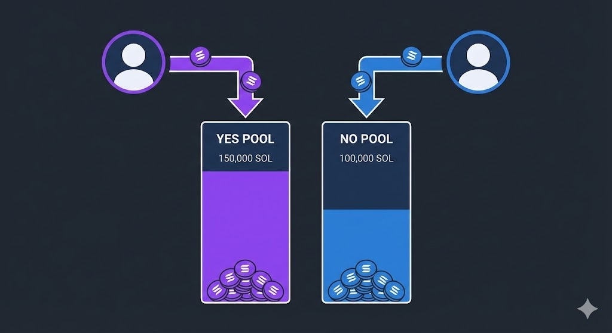
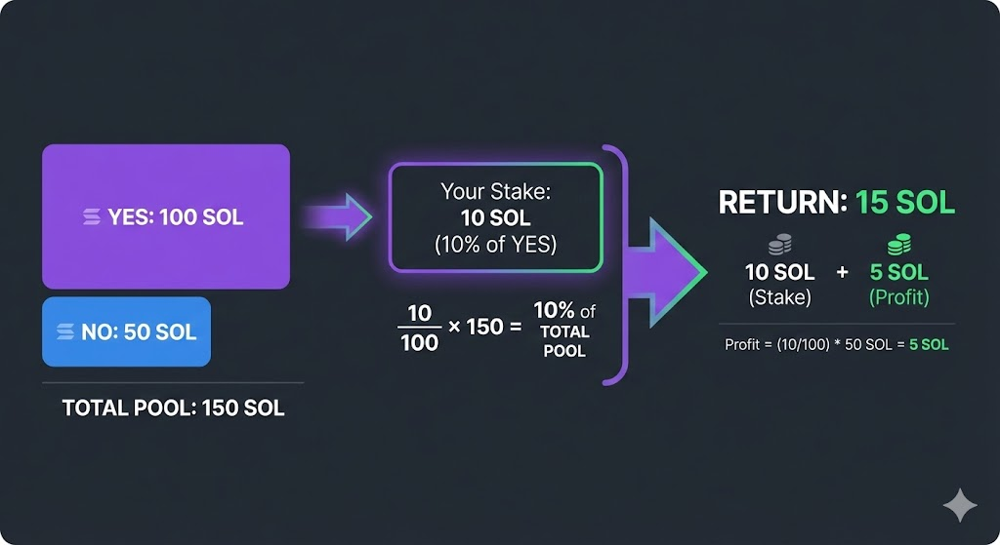
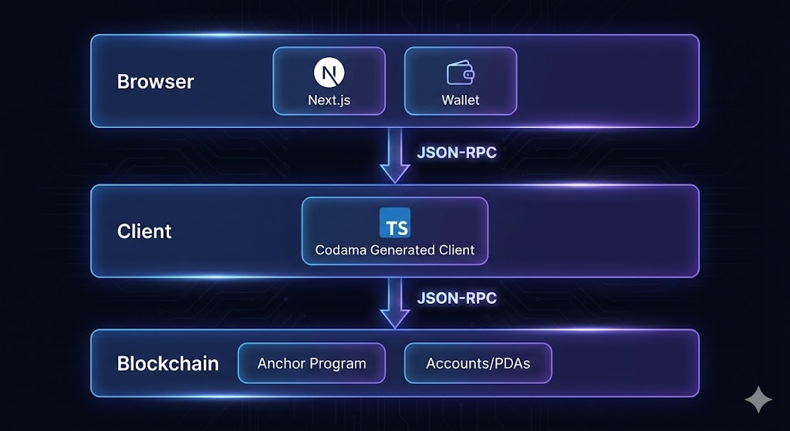
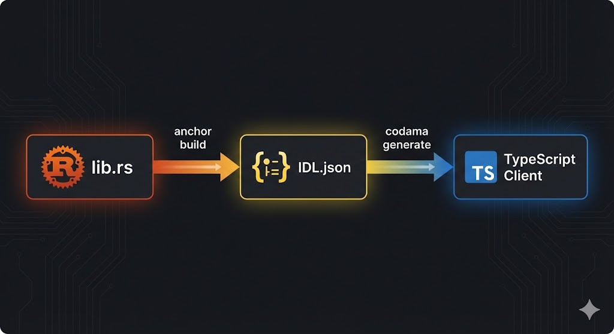
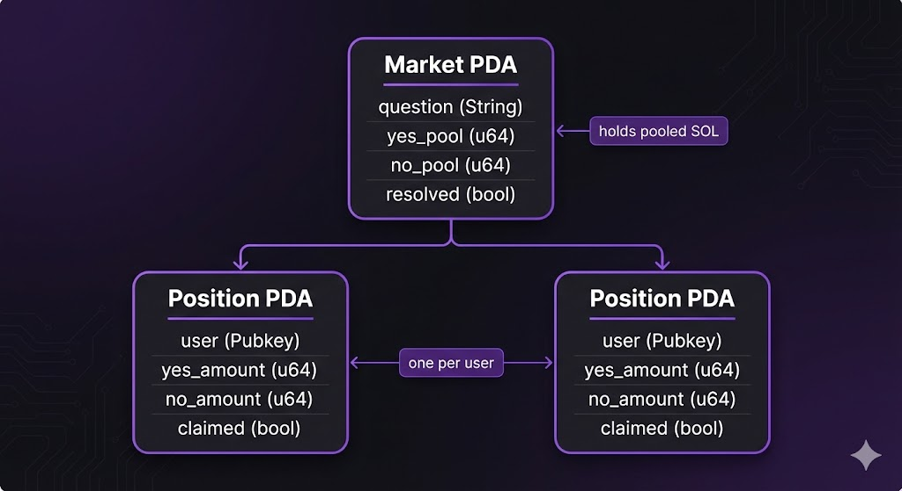
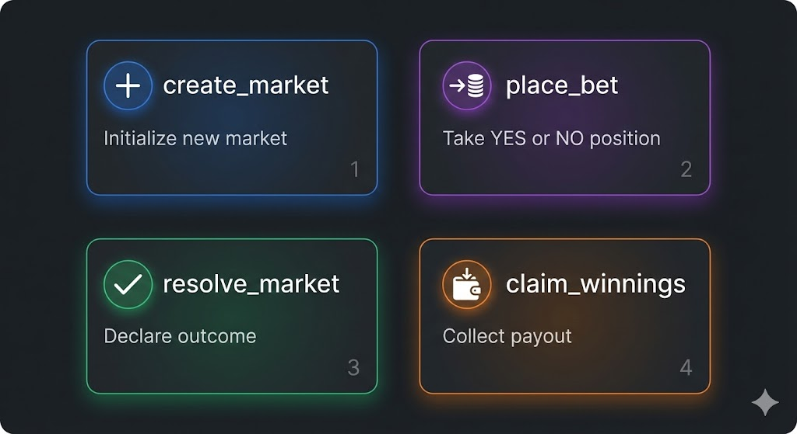

# Prediction Markets: Background and Architecture

## Overview

Prediction markets let participants take positions on the outcome of a future event. Prices emerge from the collective positions of traders rather than from a central authority.

Most markets use binary questions with complementary outcomes:

- "Will the price of Bitcoin close above $150,000 in 2026?"
- "Will candidate X win the election?"

Binary questions can be composed into ranges. For example:

- "Will the price of Bitcoin finish above $150,000 but below $200,000?"
- "Will the price of Bitcoin finish above $200,000?"

This implementation uses binary YES/NO markets. Supporting only two outcomes keeps the on-chain logic small while still covering the core mechanics of a prediction market.

## Why Solana

Prediction markets benefit from low transaction fees and fast confirmation times. Small positions are only practical when transaction costs are a small fraction of the stake. Solana's fee model and throughput make frequent, low-value positions viable.

The payout model also relies on transparent, deterministic accounting. All pools, positions, and resolution state live in on-chain accounts, so every payout can be verified against the same state transitions.

## Market Mechanics

When a participant takes a position, their funds enter a pool. Each market has two pools:

- A YES pool
- A NO pool

After the outcome is resolved, the winning side receives its stake back plus a proportional share of the losing pool. This is a parimutuel model: participants on the same side share the losing pool in proportion to their stake.

### Payout Example

Consider a market with:

- 100 SOL in the YES pool
- 50 SOL in the NO pool

A participant stakes 10 SOL on YES, representing 10% of the YES pool. If YES wins:

- The participant receives the 10 SOL stake back.
- The participant receives 10% of the 50 SOL NO pool, or 5 SOL.
- Total payout: 15 SOL.

If NO wins, the 10 SOL stake is distributed to the NO side.

The ratio between the pools acts as an implied probability. If more participants expect YES to win, more capital enters the YES pool and the potential payout for YES decreases. Participants who disagree can take the other side, which moves the ratio toward the market's collective estimate.

## Implementation Scope

The repository implements the complete flow across four on-chain instructions:

1. **`create_market`** — Initializes a market with a question and resolution deadline.
2. **`place_bet`** — Adds a position on YES or NO.
3. **`resolve_market`** — Sets the winning outcome after the deadline.
4. **`claim_winnings`** — Transfers the participant's payout.

Two account types hold all state:

- `Market` — Global market state, including both pools and resolution data.
- `UserPosition` — A single participant's cumulative YES and NO positions for one market.

Both are PDAs, so their addresses are derived deterministically from their seeds.

## System Architecture

The frontend uses Next.js with two pages:

- A markets page for creating markets, browsing active markets, and placing positions.
- An activity page for viewing positions and profit-and-loss information.

Wallet connection and RPC communication use `@solana/client` and `@solana/react-hooks`. Program instructions and account decoding use a TypeScript client generated by Codama from the Anchor IDL.

The application communicates directly with a devnet RPC endpoint. There is no indexer or database layer. The Anchor program owns the market and position accounts and enforces all state transitions.

## Program Interface

The program exposes four instructions:

1. **`create_market`** — Initializes a new market PDA with a question, resolution time, and empty pools.
2. **`place_bet`** — Transfers lamports into the market PDA and updates the selected pool and the participant's position.
3. **`resolve_market`** — Records the winning outcome. Resolution is restricted to the market creator and can only occur after the resolution time.
4. **`claim_winnings`** — Computes the participant's share of the losing pool and transfers the total payout.

## Design Notes

A market is two pools, a market account, and a set of instructions that move lamports under strict rules. The program does not need an order book, a pricing curve, or an off-chain matching service.

The creator-resolved outcome is a deliberate simplification. A production deployment would normally use an oracle or a multi-signature process so that no single party controls resolution.

The next section covers the account layout and instruction handlers in detail.
