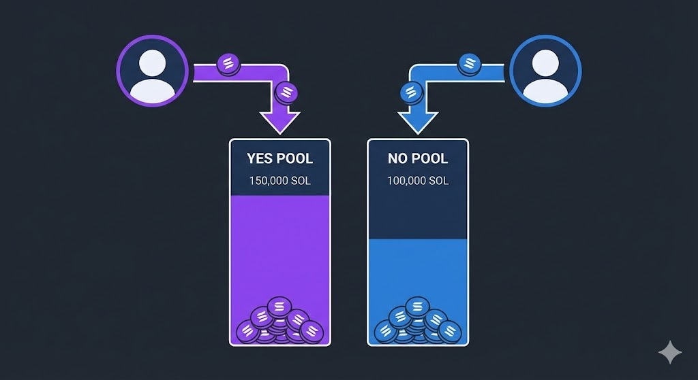
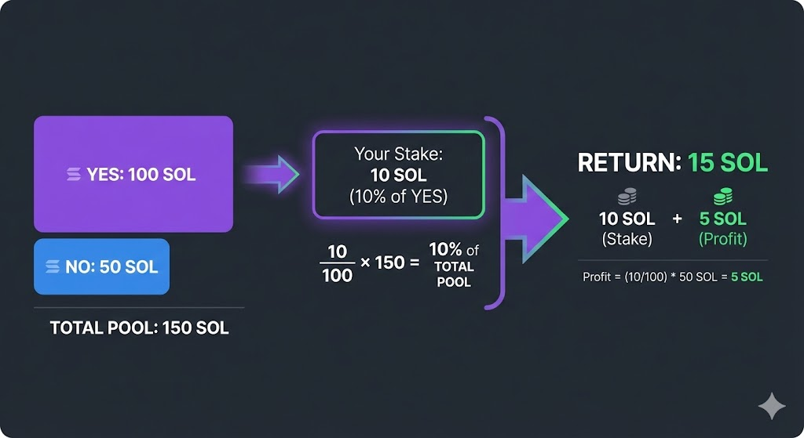
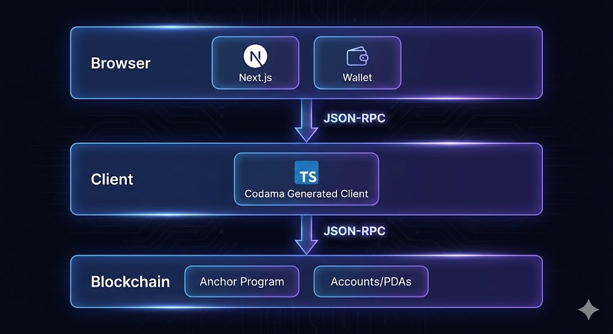
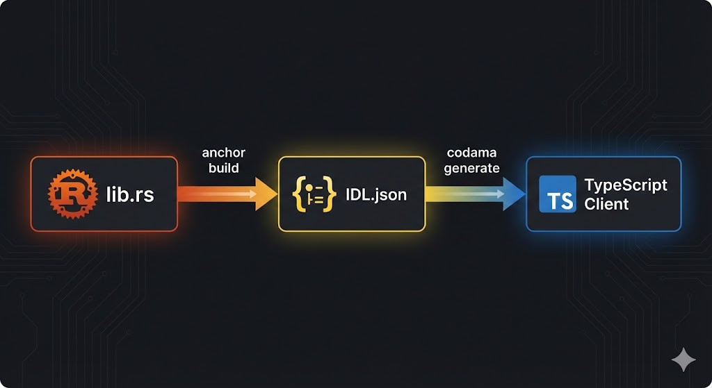
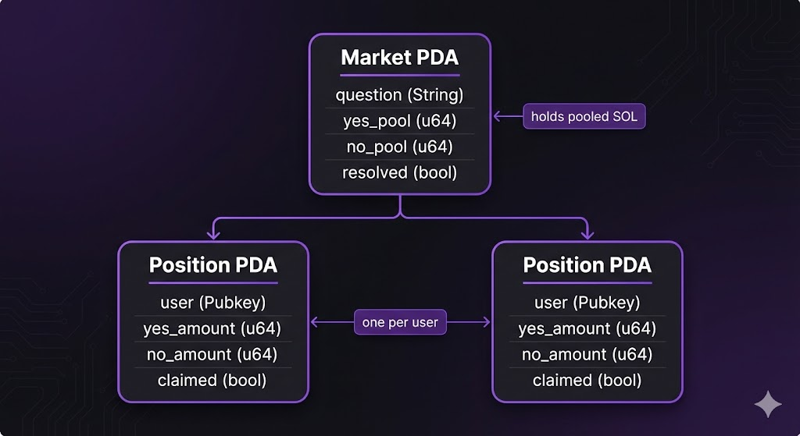
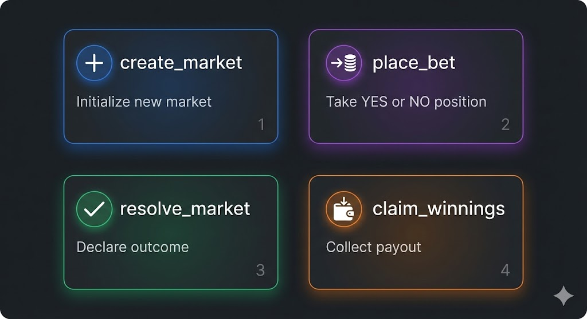

# Full-Stack Solana Prediction Markets

Technical documentation for a complete prediction market implementation on Solana. The stack includes an Anchor program, an IDL-generated TypeScript client, and a Next.js frontend.

## Contents

1. [Background](#background)
2. [Market Mechanics](#market-mechanics)
3. [System Architecture](#system-architecture)
4. [On-Chain Program](#on-chain-program)
5. [Codegen Layer](#codegen-layer)
6. [Frontend Architecture](#frontend-architecture)
7. [Security and Trade-offs](#security-and-trade-offs)
8. [Summary](#summary)
9. [File References](#file-references)

## Background

Prediction markets let participants take positions on the outcome of a future event. Prices emerge from the collective positions of traders rather than from a central authority.

Most markets use binary questions with complementary outcomes:

- "Will the price of Bitcoin close above $150,000 in 2026?"
- "Will candidate X win the election?"

Binary questions can be composed into ranges:

- "Will the price of Bitcoin finish above $150,000 but below $200,000?"
- "Will the price of Bitcoin finish above $200,000?"

This implementation supports binary YES/NO markets. Two outcomes keep the on-chain logic small while covering the core mechanics.

Solana is a practical fit because low fees and fast confirmation times make small positions viable. All pools, positions, and resolution state live in on-chain accounts, so payouts are deterministic and verifiable.

## Market Mechanics

When a participant takes a position, their funds enter a pool. Each market has a YES pool and a NO pool. After resolution, the winning side receives its stake back plus a proportional share of the losing pool.



Consider a market with 100 SOL in the YES pool and 50 SOL in the NO pool. A participant stakes 10 SOL on YES, representing 10% of the YES pool. If YES wins:

- The participant receives the 10 SOL stake back.
- The participant receives 10% of the 50 SOL NO pool, or 5 SOL.
- Total payout: 15 SOL.

If NO wins, the 10 SOL stake is distributed to the NO side.



The ratio between the pools acts as an implied probability. If more participants expect YES to win, more capital enters the YES pool and the potential payout for YES decreases. Participants who disagree can take the other side, moving the ratio toward the market's collective estimate.

This is a parimutuel model. There is no order book, pricing curve, or slippage calculation. The winning side shares the losing pool in proportion to its stake.

## System Architecture

The frontend uses Next.js with two pages:

- A markets page for creating markets, browsing active markets, and placing positions.
- An activity page for viewing positions and profit-and-loss information.



Wallet connection and RPC communication use `@solana/client` and `@solana/react-hooks`. Program instructions and account decoding use a TypeScript client generated by Codama from the Anchor IDL.



The application communicates directly with a devnet RPC endpoint. There is no indexer or database layer. The Anchor program owns the market and position accounts and enforces all state transitions.



Two account types hold all state:

- `Market` — Global market state, including both pools and resolution data.
- `UserPosition` — A single participant's cumulative YES and NO positions for one market.

Both are PDAs and have deterministic addresses derived from their seeds.

The program exposes four instructions:

1. **`create_market`** — Initializes a market with a question and resolution deadline.
2. **`place_bet`** — Adds a position on YES or NO.
3. **`resolve_market`** — Sets the winning outcome after the deadline.
4. **`claim_winnings`** — Transfers the participant's payout.



Creator-resolved outcomes are a deliberate simplification. A production deployment would normally use an oracle or a multi-signature process so that no single party controls resolution.

## On-Chain Program

On Solana, a program is a set of instructions that read and write accounts. The account layout is the program's public interface: each instruction receives accounts, validates them, and mutates their state.

### Market Account

```rust
pub struct Market {
    pub creator: Pubkey,        // 32 bytes - who can resolve
    pub market_id: u64,         // 8 bytes - unique ID
    pub question: String,       // variable - "Will X happen?"
    pub resolution_time: i64,   // 8 bytes - betting deadline
    pub yes_pool: u64,          // 8 bytes - total YES lamports
    pub no_pool: u64,           // 8 bytes - total NO lamports
    pub resolved: bool,         // 1 byte - is outcome set?
    pub outcome: Option<bool>,  // 2 bytes - None, Some(true), Some(false)
    pub bump: u8,               // 1 byte - PDA bump seed
}
```

- `creator` is the authority allowed to resolve the market. It is part of the PDA seeds, so one creator can operate multiple markets without collisions.
- `market_id` is a per-creator identifier. The seed is `b"market" + creator + market_id`, so different creators can reuse the same ID.
- `question` is capped at 200 characters. The 4-byte string length prefix and the maximum length determine the rent-exempt size.
- `resolution_time` is an `i64` Unix timestamp used to reject past deadlines and close betting.
- `yes_pool` and `no_pool` are running lamport totals. The implied probability is their ratio.
- `resolved` prevents double resolution. `outcome` represents unresolved (`None`), YES (`Some(true)`), and NO (`Some(false)`).
- `bump` lets later instructions re-derive the PDA without a client-supplied bump.

### UserPosition Account

```rust
pub struct UserPosition {
    pub market: Pubkey,      // which market this position belongs to
    pub user: Pubkey,        // owner of the position
    pub yes_amount: u64,     // lamports bet on YES
    pub no_amount: u64,      // lamports bet on NO
    pub claimed: bool,       // has the payout been claimed?
    pub bump: u8,            // PDA bump seed
}
```

- `market` and `user` bind the position to a market and owner.
- `yes_amount` and `no_amount` are cumulative totals. Both may be non-zero if a participant hedges or changes sides.
- `claimed` makes payouts idempotent.
- `bump` allows deterministic re-derivation of the position PDA.

Both accounts use `#[derive(InitSpace)]` and `#[max_len]`. Allocation uses `8 + Market::INIT_SPACE` and `8 + UserPosition::INIT_SPACE`; the leading 8 bytes are the Anchor discriminator.

### `create_market`

The `CreateMarket` accounts use `init`, `payer = creator`, `space = 8 + Market::INIT_SPACE`, and the seeds `b"market"`, the creator public key, and the `market_id` bytes. Creating the same creator and ID twice fails because the PDA already exists.

```rust
pub fn create_market(
    ctx: Context<CreateMarket>,
    market_id: u64,
    question: String,
    resolution_time: i64,
) -> Result<()> {
    require!(question.len() <= MAX_QUESTION_LEN, MarketError::Overflow);

    let clock = Clock::get()?;
    require!(
        resolution_time > clock.unix_timestamp,
        MarketError::ResolutionTimeInPast
    );

    let market = &mut ctx.accounts.market;
    market.creator = ctx.accounts.creator.key();
    market.market_id = market_id;
    market.question = question;
    market.resolution_time = resolution_time;
    market.yes_pool = 0;
    market.no_pool = 0;
    market.resolved = false;
    market.outcome = None;
    market.bump = ctx.bumps.market;

    Ok(())
}
```

Validation runs before any state change. Every field is written explicitly. `market_id` is stored for the UI and for PDA re-derivation. `resolution_time` uses `i64` to match the clock sysvar.

A production implementation would likely add a minimum duration, question-content validation, or a creation fee to limit spam.

### `place_bet`

The handler validates the input, transfers lamports into the market PDA, and updates the market and position accounts.

```rust
pub fn place_bet(
    ctx: Context<PlaceBet>,
    amount: u64,
    bet_yes: bool,
) -> Result<()> {
    require!(amount > 0, MarketError::InvalidBetAmount);

    let clock = Clock::get()?;
    let market = &ctx.accounts.market;
    require!(
        clock.unix_timestamp < market.resolution_time,
        MarketError::BettingClosed
    );

    transfer(
        CpiContext::new(
            ctx.accounts.system_program.to_account_info(),
            Transfer {
                from: ctx.accounts.user.to_account_info(),
                to: ctx.accounts.market.to_account_info(),
            },
        ),
        amount,
    )?;

    // Update pools
    let market = &mut ctx.accounts.market;
    if bet_yes {
        market.yes_pool = market.yes_pool.checked_add(amount)
            .ok_or(MarketError::Overflow)?;
    } else {
        market.no_pool = market.no_pool.checked_add(amount)
            .ok_or(MarketError::Overflow)?;
    }

    // Update user's position...
}
```

Money flow:

```
   User Wallet                    Market PDA
       │                              │
       │    transfer(amount)          │
       ├─────────────────────────────►│
       │                              │
       ▼                              ▼
  balance -= amt              yes_pool += amt
                                  (or no_pool)
```

The amount must be greater than zero, and the current time must be strictly less than `resolution_time`. Both checks run before the transfer.

The position account uses `init_if_needed`. The first bet pays rent and initializes `market`, `user`, and `bump`; later bets reuse the account. Each bet increments either `yes_amount` or `no_amount`.

A participant may hold both YES and NO positions. This supports hedging or changing a view without closing an account. At resolution, only the winning side is paid.

Pool updates use `checked_add`. Wrapping a pool to zero would distort the implied price and could enable theft.

### `resolve_market`

Resolution is performed by the market creator after `resolution_time`. The instruction records the winning outcome and sets the market's resolved state.

`claim_winnings` requires `market.resolved` before any payout, so resolution must complete first. Creator-only resolution is a trust assumption; a production system would typically use an oracle or multi-signature process.

### `claim_winnings`

Settlement verifies the resolved state, checks that the position has not been claimed, computes the payout, transfers lamports, and marks the position as claimed.

```rust
pub fn claim_winnings(ctx: Context<ClaimWinnings>) -> Result<()> {
    let market = &ctx.accounts.market;
    let position = &ctx.accounts.user_position;

    // Guards
    require!(market.resolved, MarketError::NotResolved);
    require!(!position.claimed, MarketError::AlreadyClaimed);

    // Determine winning side
    let outcome = market.outcome.unwrap();
    let (user_winning_bet, total_winning_pool, total_losing_pool) = if outcome {
        (position.yes_amount, market.yes_pool, market.no_pool)
    } else {
        (position.no_amount, market.no_pool, market.yes_pool)
    };

    require!(user_winning_bet > 0, MarketError::NoWinnings);

    // Calculate payout
    let winnings = (user_winning_bet as u128)
        .checked_mul(total_losing_pool as u128)
        .ok_or(MarketError::Overflow)?
        .checked_div(total_winning_pool as u128)
        .ok_or(MarketError::Overflow)? as u64;
    let total_payout = user_winning_bet
        .checked_add(winnings)
        .ok_or(MarketError::Overflow)?;

    // Transfer from PDA to user
    let market_account_info = ctx.accounts.market.to_account_info();
    let user_account_info = ctx.accounts.user.to_account_info();

    **market_account_info.try_borrow_mut_lamports()? -= total_payout;
    **user_account_info.try_borrow_mut_lamports()? += total_payout;

    let position = &mut ctx.accounts.user_position;
    position.claimed = true;

    Ok(())
}
```

Payout formula:

```
winnings = (user_bet / winning_pool) * losing_pool
total = user_bet + winnings
```

Payout example:

```
Example Market:
┌─────────────────────────────────────┐
│  YES Pool: 100 SOL                  │
│  NO Pool:   50 SOL                  │
│  Outcome: YES wins                  │
└─────────────────────────────────────┘

User bet 10 SOL on YES:
┌─────────────────────────────────────┐
│  Share of winners: 10/100 = 10%     │
│  Claim from losers: 50 × 10% = 5    │
│  Total payout: 10 + 5 = 15 SOL      │
└─────────────────────────────────────┘
```

The implementation multiplies in `u128` before dividing to avoid overflow. Integer division floors the result, so a few lamports may remain in the market PDA as dust. This is deterministic and expected.

Lamports are moved by mutating the account balances directly. The system program only moves lamports from signer accounts, and the market PDA is program-owned. Account constraints validate that the `UserPosition` PDA matches the signer.

After the transfer, `position.claimed` is set to `true`. A repeated claim fails at the guard. The position account is not closed in this version; a `close = user` constraint could reclaim rent after a claim.

If a participant holds both sides, only the winning side pays out. The losing side remains in the pool and is distributed to winners, including the participant if they hold a winning position. All lamports entering the market are either paid out or remain as dust.

## Codegen Layer

The codegen layer connects the Rust program to the TypeScript frontend. It removes hand-written PDA derivation, instruction serialization, and account decoding from the application code.

The Rust program is the source of truth. The Anchor IDL is the schema, and the generated TypeScript client is what the frontend imports.

```
┌─────────────┐      ┌─────────────┐      ┌─────────────┐
│   lib.rs    │      │  IDL.json   │      │ TypeScript  │
│   (Rust)    │─────▶│ (Schema)    │─────▶│  Client     │
└─────────────┘      └─────────────┘      └─────────────┘
     anchor build         codama:js

   Source of           Intermediate        What frontend
   truth               representation      imports
```

Commands:

```bash
npm run anchor-build   # Rust → IDL
npm run codama:js      # IDL → TypeScript
```

`anchor-build` compiles the program and emits an IDL JSON file containing instructions, accounts, types, and errors. `codama:js` reads the IDL and generates a TypeScript client with instruction builders, PDA helpers, account decoders, and error types. The output is written to `app/generated/prediction_market/`.

The generated client must be regenerated whenever a Rust account, instruction, or error changes. Generated files are build output and should not be hand-edited.

A mismatch between the program and the frontend usually means the IDL or generated client is stale. Rebuilding and regenerating resolves that class of deserialization error.

The IDL is language-neutral and can be used to generate clients for other languages. The generated IDL is available at `anchor/target/idl/`. It lists every instruction, account layout, field name, and error.

### Generated Client Example

IDL snippet:

```json
// IDL snippet (anchor/target/idl/prediction_market.json)
{
  "name": "placeBet",
  "args": [
    { "name": "amount", "type": "u64" },
    { "name": "betYes", "type": "bool" }
  ]
}
```

Generated TypeScript:

```typescript
// Generated: app/generated/prediction_market/instructions/placeBet.ts
export async function getPlaceBetInstructionAsync(
  input: PlaceBetAsyncInput
): Promise<PlaceBetInstruction> {
  // Auto-derives PDAs from seeds
  const marketAddress = await findMarketPda(input.creator, input.marketId);
  const positionAddress = await findPositionPda(marketAddress, input.user);

  // Encodes args to bytes
  const data = getPlaceBetInstructionDataEncoder().encode({
    amount: input.amount,
    betYes: input.betYes,
  });

  return { keys: [...], data, programId };
}
```

The generated client handles:

- **PDA derivation** — It derives `Market` and `UserPosition` addresses from the same seeds as the program.
- **Serialization** — It encodes arguments in Borsh order. `u64` values map to `bigint` in TypeScript.
- **Account metas** — It orders accounts and sets writable and signer flags.
- **Account decoding** — Decoders read accounts from raw bytes, including the 8-byte Anchor discriminator.
- **Typed errors** — Program errors map to typed frontend errors.
- **Discriminators** — RPC filters can select only the expected account type.
- **Program ID** — The generated package exports the program ID as a constant.
- **Typed interfaces** — Decoded accounts expose exact field names and types.
- **Sync and async builders** — Async builders derive PDAs; sync builders work with precomputed addresses.

Encoders and decoders are pure functions and can be tested in isolation. Generated clients may be committed so a clone can run without a codegen step, or regenerated in CI. In both cases the generated directory is build output rather than hand-written source.

## Frontend Architecture

### Component Structure

The frontend uses the Next.js App Router. The root layout wraps the application in `Providers`, which supplies the Solana connection and wallet state.

```
App (layout.tsx)
 └─ Providers (Solana client + wallet)
     ├─ HomePage (page.tsx)
     │   ├─ CreateMarketForm
     │   └─ MarketsList
     │       └─ MarketCard (×N)
     │
     └─ ActivityPage (activity/page.tsx)
         └─ PositionsList
             └─ PositionCard (×N)
```

`Providers` is a client component because wallet adapters depend on `window`. The layout can remain server-rendered.

The home page provides market creation and browsing:

- `CreateMarketForm` collects a question and resolution time, calls `create_market`, and resets the form.
- `MarketsList` fetches markets and renders a `MarketCard` for each one.

The activity page uses `PositionsList` to fetch the connected wallet's positions. Each `PositionCard` displays the position amount, market outcome, and claim status.

`Providers` centralizes the cluster and RPC connection in `app/components/providers.tsx`. The repository targets devnet, but the same structure supports mainnet, localnet, or a custom RPC.

State is local to the components that need it. `MarketCard` receives a decoded market and callbacks; there is no global store.

### Data Fetching

The frontend reads directly from the RPC. There is no indexer or database layer.

```typescript
// Fetch all Market accounts from the program
const fetchMarkets = async () => {
  const response = await fetch(RPC_URL, {
    method: 'POST',
    body: JSON.stringify({
      method: 'getProgramAccounts',
      params: [
        PROGRAM_ID,
        {
          filters: [{
            memcmp: {
              offset: 0,
              bytes: "dkokXHR3DTw"  // Market discriminator
            }
          }]
        }
      ]
    })
  });

  // Decode each account
  const markets = accounts.map(acc => {
    const data = base64ToBytes(acc.data);
    return getMarketDecoder().decode(data);
  });
};

// Poll every 3 seconds
useEffect(() => {
  const interval = setInterval(fetchMarkets, 3000);
  return () => clearInterval(interval);
}, []);
```

`getProgramAccounts` returns every account owned by the program. Anchor prepends an 8-byte discriminator to each account type. Filtering on the `Market` discriminator excludes `UserPosition` accounts.

The generated `getMarketDecoder()` matches the Rust struct layout, so account bytes are not parsed by hand.

Fetching should be wrapped in error handling with loading and retry states. The interval is cleared on unmount so navigation does not leave multiple intervals running.

Polling every three seconds is simple and reliable but not real-time. WebSockets or an indexer would reduce latency in a larger deployment.

Derived values such as implied probability (`yes_pool / (yes_pool + no_pool)`) and total liquidity (`yes_pool + no_pool`) are computed in the client.

The activity page follows the same pattern for `UserPosition` accounts. Positions can be filtered on the client or by user public key with a `memcmp` offset after the discriminator and market key.

Markets can be grouped into active and resolved by comparing `resolution_time` with `Date.now() / 1000`. Pool values are stored in lamports and should be converted with `lamports / LAMPORTS_PER_SOL` for display.

As the number of markets grows, `getProgramAccounts` becomes heavier. An indexer or cached result set is the next step for larger deployments.

Discriminator filtering:

```
Program owns many accounts:
┌──────────────────┐
│ [disc: Market]   │ ← matches filter ✓
│ question: "..."  │
└──────────────────┘
┌──────────────────┐
│ [disc: Position] │ ← doesn't match ✗
│ user: 0x...      │
└──────────────────┘
┌──────────────────┐
│ [disc: Market]   │ ← matches filter ✓
│ question: "..."  │
└──────────────────┘
```

### Transaction Flow

All instructions follow the same pattern: build an instruction with the generated client, send it through the wallet, and refresh the UI on the next poll.

```typescript
const handleBet = async (betYes: boolean) => {
  // 1. Build instruction using generated client
  const instruction = await getPlaceBetInstructionAsync({
    market: marketAddress,
    user: wallet.address,
    amount: BigInt(solAmount * LAMPORTS_PER_SOL),
    betYes,
  });

  // 2. Send transaction
  await sendTransaction({
    instructions: [instruction],
  });

  // 3. UI updates on next poll (3s)
};
```

The instruction builder is fully typed. Incorrect argument types or missing accounts are reported by TypeScript at compile time.

After `sendTransaction`, the UI can show a toast, set a pending flag, or optimistically update the affected market. This implementation relies on polling so the displayed state stays consistent with on-chain state.

`u64` values map to `bigint` in TypeScript. The handler converts the SOL amount to lamports and then to `BigInt` to avoid precision loss.

For stronger transaction feedback, wait for confirmation with `connection.confirmTransaction(signature)` and clear the pending state after the transaction lands.

The same pattern applies to the other instructions:

- `create_market` builds an instruction with a question and resolution time.
- `resolve_market` requires the creator's signature.
- `claim_winnings` uses the participant's position PDA.

Handlers should catch wallet rejections and program errors. The generated client exposes typed errors, which can be mapped to messages such as "Betting is closed".

For `create_market`, the date input must be converted to a Unix timestamp:

```typescript
Math.floor(date.getTime() / 1000)
```

The value must match the program's `resolution_time`; otherwise the transaction fails with `ResolutionTimeInPast`.

Useful UI details include disabling bet buttons while a transaction is pending and displaying current pool sizes on each card.

A "Transaction too large" or "Blockhash not found" error during testing is usually a devnet or wallet timing issue; retrying with a fresh blockhash resolves it.

Optimistic UI is optional: pool totals can be updated locally after submission and reconciled on the next poll.

Full round trip:

```
User clicks          Build            Sign &           Program          Account
"Bet YES"      →   Instruction   →    Send       →   Executes     →    Updated
                        │                               │
                   Generated               Validation + state change
                   client                  (checked_add, time check)
```

## Security and Trade-offs

This implementation prioritizes a small, auditable program and a clear end-to-end flow. Several production concerns are intentionally out of scope.

### Design Decisions

| Choice | Trade-off |
| --- | --- |
| Creator resolves market | Simple but centralized trust |
| Polling vs WebSockets | Simpler code, slightly delayed updates |
| All-or-nothing bets | No partial positions, simpler math |
| No fees | No protocol revenue, pure market |

- **Resolution** — The creator decides the outcome. A production deployment would use an oracle or multi-signature process.
- **Polling** — Simple to implement, but adds latency and RPC load.
- **Position model** — All-or-nothing bets keep accounting simple but disallow partial exits or liquidity.
- **Fees** — No fees keeps the payout math pure but provides no revenue or sustainability model.

### Security Protections

| Attack Vector | Protection |
| --- | --- |
| Overflow attacks | `checked_add/mul/div` |
| Double claims | `position.claimed` flag |
| Late bets | Time window validation |
| Unauthorized resolution | Creator-only check |

Pool updates use checked arithmetic. Payout multiplication uses `u128` intermediates before conversion back to `u64`.

`claim_winnings` requires `market.resolved` and rejects positions where `claimed` is already true. Claims are therefore idempotent and cannot be repeated.

The `UserPosition` PDA is validated against the signer through account constraints, so a caller cannot claim another participant's position.

`place_bet` rejects transactions at or after `resolution_time`. `resolve_market` is restricted to the market creator and can only run after the deadline.

### Known Limitations

- The creator can resolve early or select an incorrect outcome.
- There is no cost or stake requirement for creating markets, so spam markets are possible.
- Transaction ordering and deadline races are not mitigated.
- There is no fee, treasury, or protocol revenue.
- Positions cannot be partially exited or sold before resolution.
- The frontend polls instead of subscribing to account changes.
- Position accounts are not closed after claims, so rent is not reclaimed.

### Potential Extensions

- Decentralized oracles such as Switchboard or Pyth for trustless resolution
- A fee mechanism for protocol sustainability
- Partial position exits or liquidity
- Multi-outcome markets instead of binary YES/NO
- Market creation fees or reputation to reduce spam
- An on-chain finalization window to reduce deadline racing
- WebSockets or an indexer for real-time account updates

A fee changes the payout math and requires careful rounding and accounting. Oracle resolution changes the trust model and the instruction set.

## Summary

```
┌─────────────────────────────────────────────────────────────┐
│  1. User interacts with React component                     │
│  2. Component calls generated instruction builder           │
│  3. Wallet signs, transaction sent to Solana                │
│  4. Anchor program validates & mutates account state        │
│  5. Frontend polls for updated state, re-renders            │
└─────────────────────────────────────────────────────────────┘
```

The application has one repeating loop:

1. A user action builds an instruction with the generated client.
2. The wallet signs and submits the transaction.
3. The Anchor program validates the accounts and updates state.
4. The frontend polls for updated account data and re-renders.

The on-chain program is small: two account types, four instructions, and a fixed set of validation rules. The frontend mirrors that structure with two pages and a shallow component tree.

Key properties:

1. **Programs are stateless** — All market and position data lives in accounts.
2. **PDAs hold funds** — Market accounts have no private keys; only the program can sign for them.
3. **Codegen removes serialization risk** — Instruction data and account layouts come from the IDL.
4. **The IDL is the interface contract** — It connects the on-chain program to the generated client.

The account model is the source of truth. Market pools, resolution state, and participant positions can all be reconstructed from on-chain accounts without an external database.

Design principles:

- Keep the state model small and explicit.
- Validate inputs before changing state.
- Prefer deterministic PDA derivation over registry accounts.
- Treat generated client code as build output.
- Keep on-chain and off-chain types synchronized through codegen.

## Resources

- [Anchor documentation](https://www.anchor-lang.com/)
- [Solana Cookbook](https://solanacookbook.com/)
- [Codama](https://github.com/codama-idl/codama)

## File References

| Topic | File Path |
| --- | --- |
| Account structures | `anchor/programs/prediction_market/src/state.rs` |
| Program instructions | `anchor/programs/prediction_market/src/lib.rs` |
| Error definitions | `anchor/programs/prediction_market/src/errors.rs` |
| Generated client | `app/generated/prediction_market/` |
| Markets list component | `app/components/markets-list.tsx` |
| Market card component | `app/components/market-card.tsx` |
| Wallet providers | `app/components/providers.tsx` |
| Codama config | `codama.json` |
